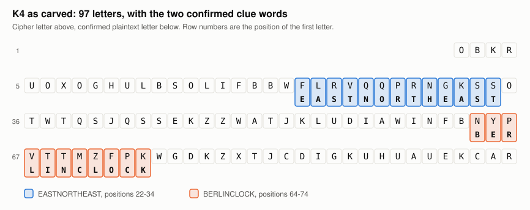
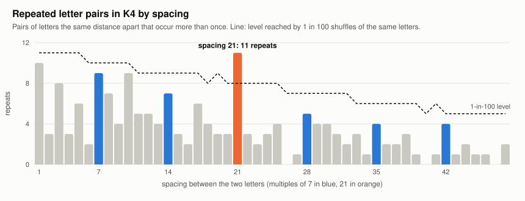
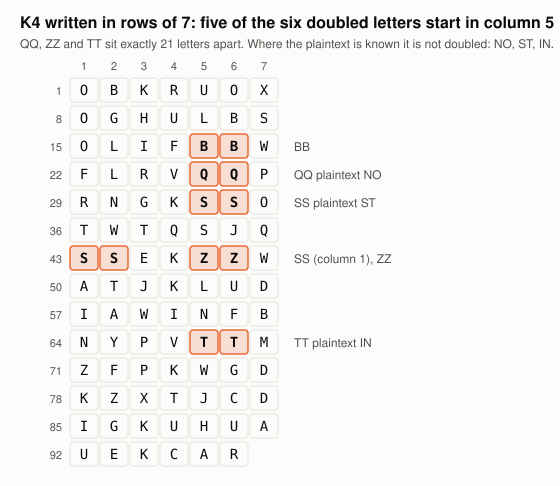
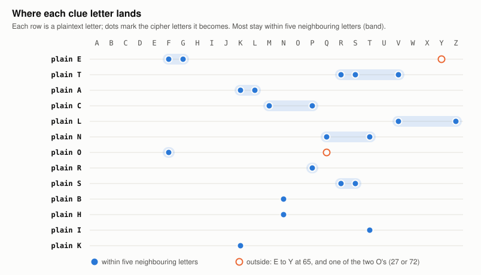

# Kryptos K4: an open research notebook

*Kryptos* is Jim Sanborn's 1990 sculpture at CIA headquarters. Three of its four
encrypted passages were solved in the 1990s. The fourth, **K4**, is 97 letters long
and its method has never been found.

**This repository does not solve K4.** It is a record of a systematic attempt: a
toolkit of tests, each one checked against a planted solution, and a map of what
K4 is *not*. We publish it so others don't have to repeat the same dead ends, and
so the ideas that survived can be picked up.



## Status (4 October 2026)

- **Unsolved.** Neither the plaintext nor the method is public.
- **The plaintext exists privately.** It was found in Sanborn's Smithsonian papers
  in September 2025; he confirmed it. His archive was sold in November 2025 to
  Paradigm, which runs a $1-per-guess answer checker and holds the unreleased
  ciphertext of a companion message, K5.
- **What is confirmed:** 24 of the 97 plaintext letters. `EASTNORTHEAST` at
  positions 22–34 and `BERLINCLOCK` at 64–74.

## What we found

### 1. The key has no structure we can recognise

Working backwards from the clue words gives the key at 24 positions. On the plain
A–Z table it must read `BLZCDCYYGCKAZ` under EASTNORTHEAST and `MUYKLGKORNA` under
BERLINCLOCK. Those letters do not repeat, do not spell anything, and do not occur
in any text we could find. Every rule we could state for where they come from was
tested and failed (see the table below).

### 2. The ciphertext has a real "interval 7" pattern

Letter pairs 21 places apart repeat far more often than in shuffled copies of the
same letters, and the next most unusual spacings are also multiples of 7. NSA's
analysts noted the same "slight interval 7 property" in a document declassified in
2014.



Most of it comes from the doubled letters. Five of the six start in the same column
when K4 is written seven to a row, and three of them (QQ, ZZ, TT) are exactly 21
apart. Where the plaintext is known, it is not doubled.



No method we tested explains this.

### 3. Each clue letter lands in nearly the same place

Plaintext `A` becomes `K` or `L`; `S` becomes `R` or `S`; `T` becomes `R`, `S` or
`V`. If two of the 24 clue letters are set aside, the rest fit "a fixed letter
table, plus a number from 0 to 4". Shuffled clues do that about 1 time in 350
(roughly 1 in 60 after allowing for the choices involved). It is a sharper form of
an observation made by Richard Bean in 2021.



We could not find a rule for the numbers, and the other 73 letters give it no
support, so we report it as a pattern, not a result.

### 4. Leads from Sanborn's own papers

Read from photographs of his working papers (Archives of American Art):

- His 1990 dedication remarks: the Vigenère table was used "to encipher the top
  plate", and "there are two systems of enciphering the bottom text… that is a
  major clue in itself". The bottom plate is K3 and K4.
- A notebook list: "Beaufort cipher / Compass cipher / Morse code / Alphabet code".
- His handwritten KRYPTOS table with three circled cells (T, K, H), two of them on
  the diagonal and one on the row that carries the sculpture's extra `L`.

None of these has yet been turned into a method that fits.

## What has been ruled out

Each line is a family of methods, tested so that no key has to be guessed wherever
possible. Full tables are in [docs/RESULTS.md](docs/RESULTS.md).

| family | scale | outcome |
|---|---|---|
| Any repeating key (periods 1–26) on the A–Z or KRYPTOS table, and two keys laid over each other (periods up to 30) | complete | impossible |
| Self-keying (autokey), any seed, any lag | complete | impossible |
| Keyword-built alphabets with any repeating key | 37.7 million keywords | none |
| Column rearrangements, every order of widths 2–15, with any repeating key | 2.8 trillion arrangements (GPU) | none |
| Rotations, routes, mirrors, rail fence, K3's own recipe, with any repeating key | about 200,000 arrangements | none |
| Key chains: a text decoded by one key becomes the next key (two and three levels) | 56 billion chained keys; 1.5 trillion with a rearrangement | none above chance |
| Masking table (any of 26!) plus any repeating key, allowing two slips | complete | none |
| One known alphabet, one unknown, any repeating key up to 24 | annealing on full-text English | best −5.18 (English is −4.3) |
| Period-8 key with two unknown alphabets | all 4.5 million keys the clues allow | best −4.93 |
| Gromark and other digit keys | every primer of length 2–8; every 8-digit key | none |
| Key read from the sculpture (either side, any regular reading order) | 5.8 million placements | chance |
| Key read from public texts (Bible, Declaration, dictionary, Shakespeare…) | 95 million letters, skips up to 40 | none |
| Light projection, overlays, ray trace through the S-shaped screen | 1.7 million pairings; parametric ray trace | chance |
| Compass schemes, including the KRYPTOS alphabet laid round the rose | all simple readings | none |
| Trifid, Bifid 6 × 6, five-bit fractionation | all block lengths | impossible |
| Pair ciphers: Slidefair, four-square and two-square on a 26-letter rectangle | 463 million decryptions | none |
| Hill 2 × 2 to 4 × 4, polynomial and recurrence keys | complete | none |

"None" means nothing reproduced the 24 clue letters beyond what chance predicts for
a search of that size.

## What is still open

- **A long key that is not in any text we have**, for example a list on Sanborn's
  coding chart. This is our leading explanation and cannot be derived from 24 letters.
- **Two unrelated mixed alphabets with a key longer than 8.** Too many keys to list,
  and annealing cannot find the key and both alphabets together.
- **A method that is not letter arithmetic at all.** Sanborn speaks of "visual
  systems"; his notes mention a "compass cipher".
- **K5.** Sanborn says it uses a similar system and shares coded words in the same
  positions as K4. If the key depends only on position, the two ciphertexts
  together would expose it.

## Repository layout

```
README.md            this page
docs/
  RESULTS.md         every test, with sizes, controls and outcomes
  CLUES.md           every statement by Sanborn and Scheidt we could source, with verification level
  figures/           the charts above (regenerate with k4/figures.py)
k4/                  the code: Python 3 standard library only, plus small C / OpenCL helpers
```

The modules import each other by name, so they live together in `k4/`. By topic:

| topic | modules |
|---|---|
| Ground truth and scoring | `kryptos.py` (ciphertext, clues), `sculpture.py` (full transcription of both sides), `texts.py`, `quadgrams.py`, `scoring.py`, `ciphers.py` |
| Repeating keys and rearrangements | `cribdrag.py`, `frontier.py`, `masking.py`, `masks.py`, `colsweep.py` (+ `colsweep.c`, `colsweep_gpu.c`, `colsweep.cl`, `colcore.h`) |
| Unknown alphabets | `structural.py`, `keyedcsp.py` (+ `kwcsp.c`), `qsolve.py` (+ `qsolve.c`), `maskkey.py` |
| Several stages and key chains | `recipes.py`, `keyhunt.py`, `wordlists.py`, `chain.py`, `chaint.py` (+ `chaint.c`) |
| Number keys | `gromark.py`, `gromark_sa.py` (+ `gsolve.c`), `digits.py`, `blackbox.py`, `base5.py` (+ `b5solve.c`) |
| Keys from texts and the sculpture | `padsearch.py`, `block.py` |
| Physical readings | `projection.py`, `raycast.py` (+ `raycast.c`), `compass.py` |
| Other families | `trifid.py`, `pairs.py` |
| Candidate plaintexts | `candidate.py`, `guess.py`, `solvekryptos_check.py` |
| Launcher and figures | `main.py`, `keyview.py`, `solve.py`, `figures.py` |

## Quick start

Requirements: Python 3.10+, `gcc` for the C helpers (built automatically on first
use), and optionally an OpenCL GPU for `colsweep.py … gpu`. No Python packages are
needed.

```bash
cd k4
python main.py                 # menu of every test, with rough run times
python main.py controls        # planted-solution checks
python kryptos.py              # the ciphertext, the clues and the key they imply
python candidate.py TEXT       # test a 97-letter plaintext guess for key structure
python guess.py WORD ...       # where a guessed word could stand (conditional filter)
python chain.py WORD ...       # use your own words as basic keys in the key-chain tests
python padsearch.py            # search texts for the key (see below)
```

Two tests use data that is not in the repository:

- `keyhunt.py` builds a keyword list from wordlists installed on the machine
  (`/usr/share/wordlists`, `/usr/share/dict`) and caches it in `~/.cache/krypto_k4/`.
- `padsearch.py` searches any `.txt` files you place in `~/.cache/krypto_k4/texts/`
  (we used 50 Project Gutenberg texts).

## How the tests work

- **Derive, don't guess.** Each clue letter fixes the key at its position. A rule
  for the key (a period, a feedback rule, a text) either agrees with those 24
  values or it does not, so whole key spaces are tested at once.
- **Count the checks.** A setting that passes *c* independent checks by luck has
  probability 26^−c. Large searches are expected to produce a few passes at the
  minimum; those are reported as chance and their decryptions are shown to be
  gibberish.
- **Plant and recover.** Every search is run on a message we enciphered ourselves
  with the method under test, and must find it.
- **Calibrate solvers that score English.** Flexible models will manufacture
  English from random letters. Where a solver ranks readings, it is run on planted
  English and on planted gibberish first, and K4 is only compared with those.

## About claimed solutions

Many full "solutions" to K4 circulate, including AI-generated ones. A 97-letter
text that contains the clue words can always be turned into the K4 ciphertext by
*some* key, so producing one proves nothing. `solvekryptos_check.py` shows this
for one published mechanism: it "decodes" K4 into any text at all. The only
independent check on a plaintext is Paradigm's verifier; the only check on a
method is that its key follows a rule.

## Images

The figures here are generated from the ciphertext by `k4/figures.py`. We have not
included photographs of the sculpture or of Sanborn's papers, which belong to
their owners. See:

- [CIA: the Kryptos sculpture](https://www.cia.gov/legacy/headquarters/kryptos-sculpture/)
- [Elonka Dunin's Kryptos pages](https://elonka.com/kryptos/)
- [Sanborn papers, photographs and transcriptions (kryptosbot.com)](https://kryptosbot.com/archive/)
- [The Kryptos Project: strata and compass diagrams](http://www.thekryptosproject.com/kryptos/pok/strata.php)
- [Paradigm: Project Kryptos](https://www.paradigm.xyz/writing/kryptos)

## Credits and sources

This work builds on Richard Bean's "Cryptodiagnosis of Kryptos K4" (HistoCrypt
2021), Elonka Dunin's archive of statements and transcripts, the NSA's
declassified summary, the kryptosbot.com archive research, and decades of work by
the Kryptos community. Full references are in [docs/CLUES.md](docs/CLUES.md).

The code and analysis were produced with the help of an AI coding assistant
(Claude Code). Every result here is backed by a runnable test and a control;
nothing in this repository should be read as a claimed solution.
